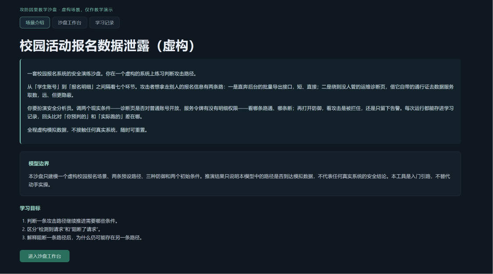
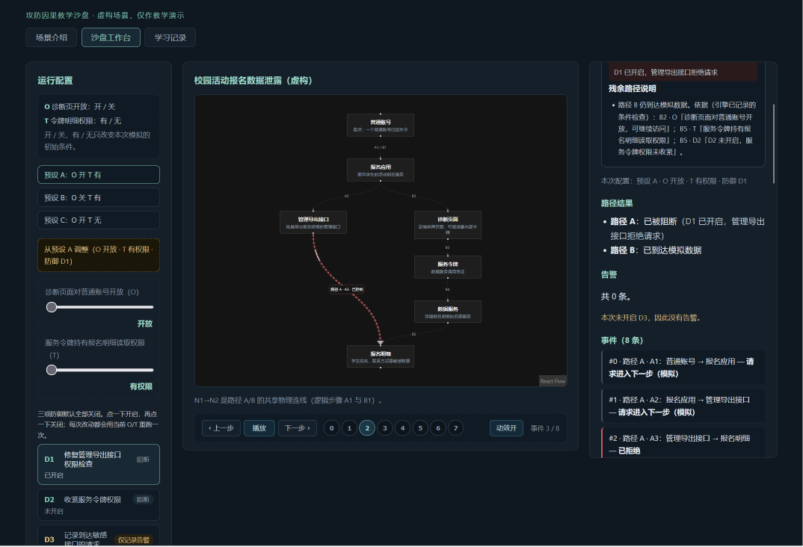
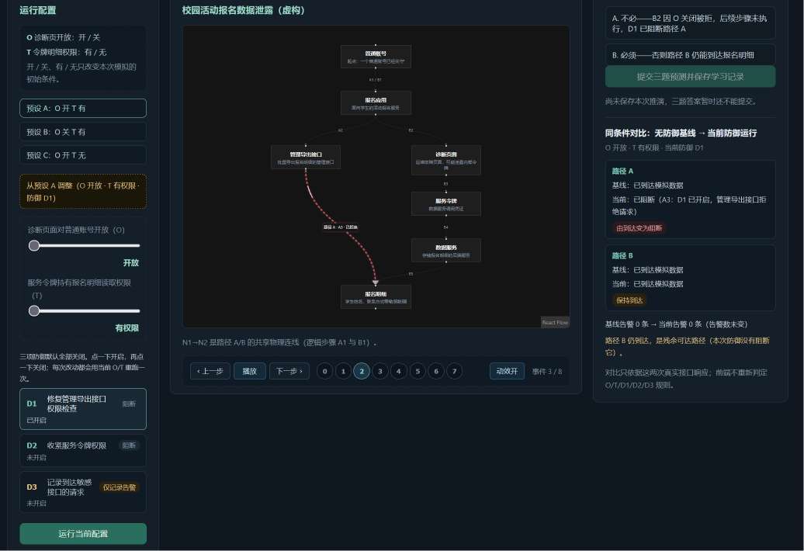
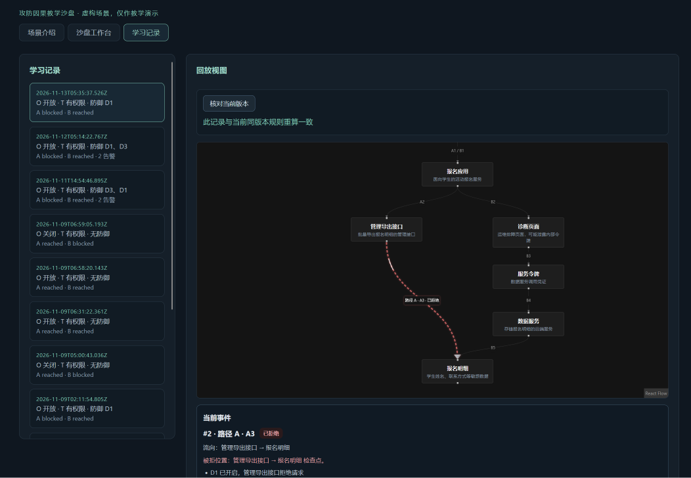

# 链路实验室｜作品介绍

> 通过改变模拟条件与防御，逐步观察两条报名数据风险路径为什么成立、被拒或留下残余路径的网安入门教学沙盘。

## 1. 项目详情与使用方式

**面向谁**：学过基础安全概念、但难以判断「攻击条件」与「防御效果」之间对应关系的网安初学者。

**解决什么学习困难**：初学者常能背出「权限检查」「最小权限」「告警」等名词，却说不清某个措施到底影响哪条路径。传统靶场要求动手操作，门槛偏高；纯文档讲解又看不到条件变化如何影响结果。本项目把「路径是否到达模拟数据」做成可交互的七节点图，让学习者在几分钟内反复改变条件、观察因果。

**虚构场景**：校园活动报名系统，教学起点为普通账号已失守。七个节点从学生账号（N1）到报名明细（N7）：

- 路径 A：N1 → N2 报名应用 → N3 管理导出接口 → N7
- 路径 B：N1 → N2 报名应用 → N4 诊断页面 → N5 服务令牌 → N6 数据服务 → N7

两个初始条件：O（诊断页是否对普通账号开放，卡在 B2）、T（服务令牌是否有明细读取权限，卡在 B5）。三种防御：D1 只阻断 A、D2 只阻断 B、D3 只产生告警、不改变任何路径成败。

**使用方式（按当前界面实际顺序）**：

1. 场景介绍页 → 点「进入沙盘工作台」→ 选预设 A（O 开、T 有）
2. 防御全关，运行一次无防御基线，两条路径都到达
3. 播放下标 0—7，逐步读每一步的条件检查理由
4. 只开 D1，自动重跑，路径 A 在 A3 被拒、路径 B 仍到达
5. 在相同 O/T 下点「运行不加防御的对照」，看对比与残余路径说明
6. 先保存这次推演，再答三题并提交学习记录
7. 学习记录页打开该记录回放，再点「核对当前版本」

**模型边界**：只建模一个虚构场景、两条预设路径、三种防御、两个初始条件。结果仅表示本模型中路径是否到达模拟数据，不代表真实系统已安全、真实攻击概率或实际防御有效性。不执行任何真实攻击、扫描或外部目标访问。

## 2. 作品亮点

**（1）同条件基线与干预对比**
在相同 O/T 下先跑无防御基线，再跑当前防御配置。界面对每条路径分别给出「基线 → 当前」的变化与理由，例如「路径 A：由到达变为阻断（A3：D1 已开启，管理导出接口拒绝请求）」「路径 B：保持到达」。换初始条件会另起一次运行，不把不同条件之间的差别算成防御效果——这条约束保证了因果解释不被混淆。

**（2）残余路径的显式呈现**
阻断一条路径后，界面主动指出另一条仍然可达，并说明它依赖哪些条件。学习者因此理解「修一处不等于安全」，这是本产品最核心的教学目标之一。

**（3）告警与阻断分离**
D3 只产生告警，不改变任何路径成败。开启 D3 后两条路径照样通，只是多出敏感请求告警。界面用侧向脉冲单独表达告警，不让它挡住主流线，并在文字中明确「检测到敏感请求，未自动阻断」。这一设计直接针对初学者最常见的误解——把「发现了」当作「拦住了」。

**（4）事件下标驱动的规则状态动画**
引擎按 A 后 B 顺序输出稳定的事件下标（A1=0 … B5=7），每个事件带路径、起终点、outcome 与条件说明。前端只持有当前下标，按该条事件在固定边上播放：未执行则流线不出现、请求被拒则撞护栏回弹、数据到达则穿透终点、D3 告警则侧向脉冲。关闭动画或系统开启「减少动态效果」时，同一事件下标的文字、边状态、节点状态完整可读——信息不以颜色或运动为唯一载体。

**（5）一句话解释随记录落库**
每次保存运行时，服务器用已判定的事件生成一句初学者能懂的解释，连同输入、结果、来源与版本一次性写入数据库。回放只读库中原文，不重新生成。

> 该解释由确定性规则模板生成，界面上标注来源为 `template`、版本 `1`。**它不是大模型输出**，本项目运行时不调用任何模型 API。

## 3. AI 辅助开发与测试技术落地

**本项目由 AI 辅助完成开发，但判定标准由人先定。**

**（1）标准答案先于实现冻结**
32 条规则期望（4 种初始条件 × 8 种防御组合）以字面量形式手写进 `packages/engine/tests/expected-runs.csv`，提交 `fb8e851`（Day 3），早于路径 A 实现 `4717f13`（Day 4）与组合推演 `d98faa3`（Day 6）。测试断言逐列核对路径 A 结果、路径 B 结果、告警数，禁止调用被测引擎生成期望值。三题的正确选项同样先手写固定（`HANDWRITTEN_CORRECT_OPTIONS`），引擎推导只用于校验，不相等则停下报告。

**（2）四条真实 Prompt 链**
开发全程的 AI 协作按阶段封存为四条链，每条含原始 Prompt、AI 建议、我的取舍、真实偏差与验证输出，原始导出文件未删改：

| 链 | 时间 | 主题 | 原始导出 |
| --- | --- | --- | --- |
| 01 | Day 2—6 | 条件与引擎及 32 条自动核对 | `evidence/iterations/01_原始对话_Day2-6.md` |
| 02 | Day 7—11 | 交互配置、同条件对比与规则状态可视化 | `evidence/iterations/02_原始对话_Day7-11.md` |
| 03 | Day 12—13 | 运行保存、历史回放与版本核对 | `evidence/iterations/03_原始对话_Day12-13.md` |
| 04 | Day 15—18 | 按需修复与最终复现 | `evidence/iterations/04_原始对话_Day15-18.md` |

索引见 `evidence/README.md`。Day 16（三位同学匿名试用）与 Day 19（重启后逐字段核对）未使用 AI 工具，已明确标为链外。

**（3）AI 生成、人工审核与自动测试的分工**
AI 负责按阶段实现代码、编写测试、定位缺陷；人负责限定改动范围（每轮 Prompt 明确冻结哪些文件）、审核每一行 diff、独立运行验证并核对数字。三条纪律贯穿全程：AI 的报告不直接采信，必须自己跑一遍；断言只允许等强度替换，不允许删除或弱化；冻结文件的 diff 必须为空。

**（4）真实 Bug 与修正**（均在当轮记录，未制造）

- 动画层整体失效：`>` 在选择器中未转义，被 CSS 解析为子代组合符，`querySelector` 静默返回 `null`，动画无报错地全部不生效
- 测试期望写错：B2 的 `blockedReason` 与引擎输出不一致，改断言不改引擎
- 三题干扰项缺陷：Q1/Q2 的干扰项与正确项共享结论词，且 Q1 干扰项陈述了该配置下不存在的告警，只改文案不改 id
- D3 标签撞断言：初稿写「记录告警，不阻断」，含「阻断」二字撞上既有 `not.toHaveTextContent("阻断")`；改文案不改断言，定为「仅记录告警」

**（5）当前测试规模**
web 66 / api 48 / engine 23，合计 137 项通过（提交 `fb87729` 后实测）。干净目录克隆复现结果与主仓库完全一致。

## 4. 关键技术与数据流

**技术栈**：React + TypeScript + Vite + React Flow（前端）；Node.js + TypeScript + Fastify（后端）；SQLite（Node 24 内置 `node:sqlite`，无 ORM）；npm workspaces 单仓库；Vitest；JSON Schema 做请求校验。

**三层责任划分**：

| 层 | 位置 | 负责 | 禁止 |
| --- | --- | --- | --- |
| 纯规则引擎 | `packages/engine` | 条件检查、事件生成、路径结果、告警计数 | 读写数据库、时间、网络、React 状态 |
| 服务与存储 | `apps/api` | 参数校验、调用引擎、SQLite 存取、模板解释 | 采信前端提交的结论 |
| 展示 | `apps/web` | 按事件下标显示、动画过渡、静态替代 | 重算成败、告警、跳过步骤 |

依赖只按 `contracts → engine → services → routes` 的业务方向传递。共享契约保证前后端数据结构一致。

**四条数据流**：

- 即时推演：滑块或防御变化 → `POST /api/evaluations` → 引擎 → 响应，不落库
- 显式保存：`POST /api/runs` → 服务器重算 → 生成模板解释 → 单条 INSERT → 返回记录 ID
- 只读回放：`GET /api/runs/:id` → 一条 SELECT → 原样返回，**不重算、不重新生成解释**
- 显式核对：`POST /api/runs/:id/verify` → 版本一致才重算 → 深度比较 → 返回三态，**对数据库零副作用**

**前端不重算**：成败、告警、跳过步骤全部来自引擎响应或库中已存记录。滑块拖动中只在前端预览档位，松手且值变化才提交一次；一次拖动最多产生一条运行。

## 5. 项目图片

图 1｜场景介绍页。顶部副标题「攻防因果教学沙盘 · 虚构场景，仅作教学演示」，下方四段说明依次交代这是什么、两条路、要做什么、全程虚构。用于证明首页回答了「我是谁、做什么、是否真实」三个问题。提交 `fb87729`。`docs/screenshots/day20-01-home.png`

图 2｜工作台，预设 A 且只开启 D1。左侧三个防御按钮分别显示「D1 已开启」「D2 未开启」「D3 未开启」；画布上路径 A 停在 N3 管理导出接口，路径 B 通到 N7 报名明细。用于证明防御状态可见、且 D1 只影响路径 A。提交 `fb87729`。`docs/screenshots/day20-02-workbench-d1.png`

图 3｜同条件对比面板。配置行显示「O 开放 · T 有权限 · 当前防御 D1」。路径 A：基线已到达 → 当前已阻断（A3：D1 已开启，管理导出接口拒绝请求），标记「由到达变为阻断」；路径 B：基线已到达 → 当前已到达，标记「保持到达」；基线告警 0 条 → 当前告警 0 条；底部指出「路径 B 仍到达，是残余可达路径」。一张图同时证明同条件对比、D1 的作用范围、残余路径、告警与阻断分离四件事。提交 `fb87729`。`docs/screenshots/day20-03-comparison.png`

图 4｜学习记录页。列表展示已保存的运行，可打开只读回放。用于证明每次运行可定格为可追溯记录、并支持事后回看。提交 `fb87729`。`docs/screenshots/day20-04-records.png`

## 6. 此前发表或获奖情况

此前未发表、未获奖。

## 7. 与已有项目的关系及原创工作

本项目**不是基于其他项目优化**：从空仓库开始构建，首个提交为需求、模型边界与范围说明，此后按日递进。

未使用任何现成的同类教学沙盘项目代码。使用的第三方组件均为通用开源库，不包含任何本领域的成品应用逻辑：

- 前端：React、TypeScript、Vite、React Flow
- 后端：Node.js、TypeScript、Fastify
- 存储：Node 24 内置 `node:sqlite`，无 ORM
- 测试：Vitest
- 校验：JSON Schema

完整依赖清单与锁定版本见 `package-lock.json`。

原创部分为：固定场景与七节点建模、两条路径的规则定义、三种防御的语义（含 D3 只告警不阻断）、32 条字面量期望、事件下标驱动的可视化白名单、同条件基线与干预对比、三题（含迁移题）与学习记录、运行保存与只读回放、零副作用的显式版本核对。