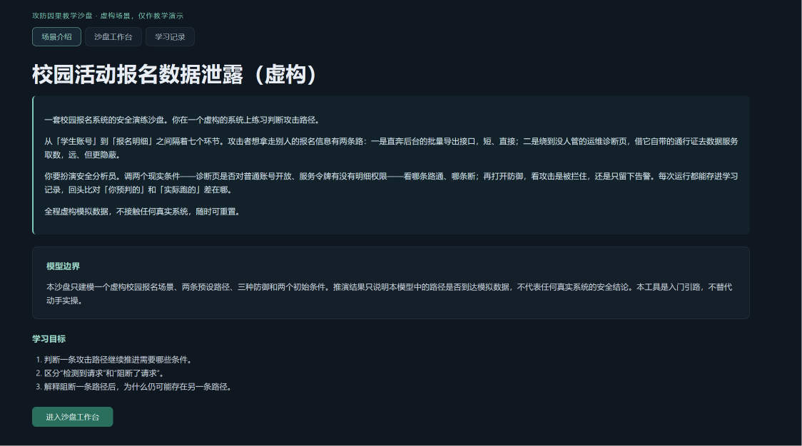
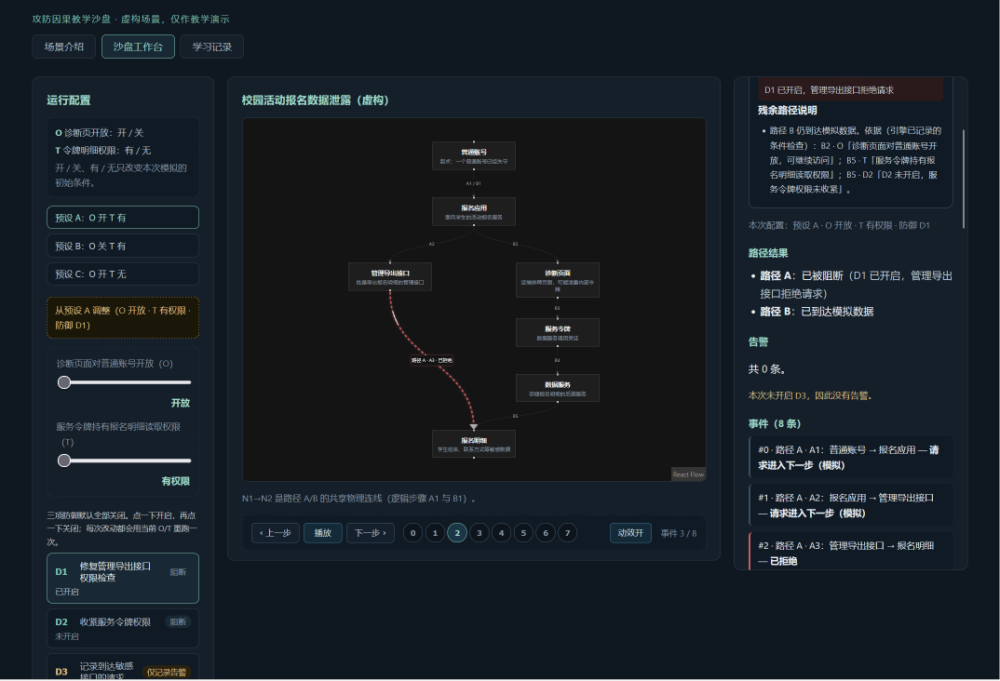
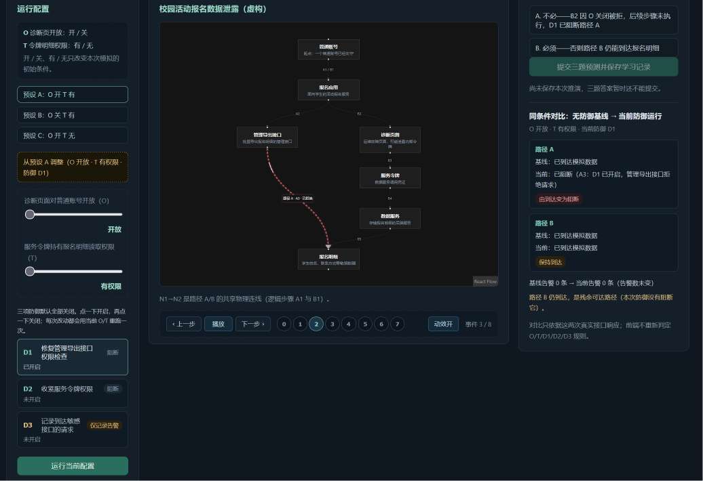
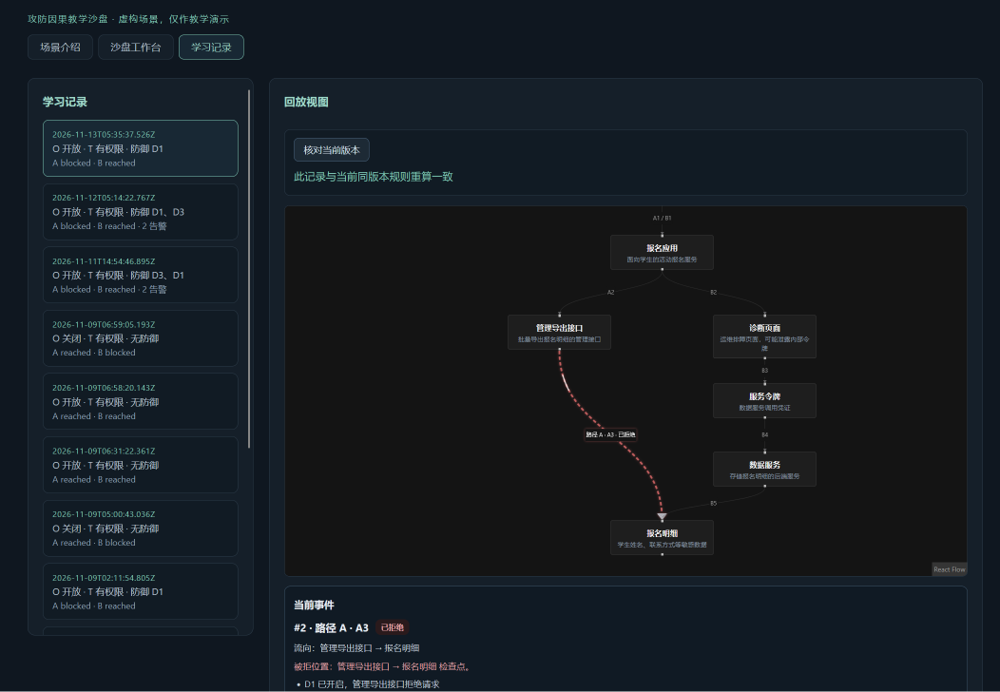

# 链路实验室 · 技术文档

> 版本：2026-11-13 定稿
> 适用提交：功能代码提交 `fb87729`；此后至 `d010718` 的提交只涉及 `docs/` 与 `evidence/`，应用代码与 `fb87729` 完全相同
> 用途：全国高校 Vibe Coding 开发挑战赛 B 组提交用技术文档，供评审核对设计约束、AI 协作过程与可复现性
> 文中所有耗时、行数、字节数均为实测值；未能验证的项目在 §8.4、§9.8 如实列出，不作推定

## 1. 痛点与访谈

- 目标使用者：学过基础安全概念、但难以判断攻击条件与防御效果之间关系的网安初学者
- 待验证困难：知道「权限检查、最小权限、告警」等名词，却难以判断它们分别影响哪条路径
- Day 1 访谈记录见 `docs/访谈笔记.md`；三位受访者共同的卡点是「这一步为什么能成立」，而不是「有哪些步骤」——看得懂结论，推不出原因。因此逐步播放必须同时展示前置条件与检查结果
- 访谈局限：未出示工作台草图，布局可用性只得到口头描述后的初步反馈，未经验证；首轮举例为文件上传等通用场景，不是校园报名。这些结论不作为已证明教学效果的依据

## 2. 范围及模型边界

- 一个虚构场景：校园活动报名系统，起点为普通账号已失守
- 七节点：N1 普通账号、N2 报名应用、N3 管理导出接口、N4 诊断页面、N5 服务令牌、N6 数据服务、N7 报名明细
- 两条路径：A `N1→N2→N3→N7`、B `N1→N2→N4→N5→N6→N7`
- 三种防御：D1 只阻 A（A3）、D2 只阻 B（B5）、D3 只产生告警不改变成败
- 两个初始条件：O（诊断页是否对普通账号开放，B2 检查）、T（服务令牌是否有明细读取权限，B5 检查）
- 八个事件下标固定：A1=0、A2=1、A3=2、B1=3、B2=4、B3=5、B4=6、B5=7
- 统一口径（README、文档、视频、PDF 一致）：结果仅表示本模型中路径是否到达模拟数据，不代表真实系统已安全、真实攻击概率或实际防御有效性。不执行任何真实攻击

## 3. 架构与数据流

### 3.1 单仓库与依赖方向

npm workspaces 单仓库，四个包。依赖只按 `contracts → engine → API → web` 的业务方向单向传递，反向依赖为零：

| 包 | 依赖 | 依据 |
| --- | --- | --- |
| `packages/contracts` | 无 | 只放共享类型与常量，不依赖任何包 |
| `packages/engine` | `contracts` | 纯函数，不引入运行时框架 |
| `apps/api` | `contracts`、`engine` | 服务层是唯一调用 `evaluateRun` 的地方 |
| `apps/web` | `contracts` | 只依赖契约，不声明 `engine` 依赖，前端在依赖层面就取不到判定函数 |

依赖方向不是约定，而是可被 `package.json` 直接验证的硬约束：`apps/web/package.json` 的 `dependencies` 只有 `@link-lab/contracts`、`@xyflow/react`、`react`、`react-dom`，`apps/web/src` 全文没有 `@link-lab/engine` 的导入。因此「前端不重算成败」不是纪律要求，而是工程上无法违反。

### 3.2 三层责任

| 层 | 位置 | 职责 | 禁止 |
| --- | --- | --- | --- |
| 纯规则引擎 | `packages/engine` | 条件检查、事件生成、路径结果、告警计数 | 读库、读时间、读网络、读 React 状态 |
| 服务与存储 | `apps/api` | 参数校验、调用引擎、SQLite 存取、模板解释 | 采信前端提交的结论（只接受输入，结果一律重算） |
| 展示 | `apps/web` | 按事件下标显示、动画过渡、静态替代 | 重算成败、告警、跳过步骤 |

三层责任划到可执行的边界：

- 引擎只接受 `{conditions, defenses}` 这一份输入，返回确定的结果对象；同一输入重复调用结果逐字节一致，不依赖系统时间、随机数或外部状态
- 服务层把前端提交的 `defenses`、`conditions` 当作待校验的输入，而不是可信结论；保存时按同一份输入重新调用引擎，用重算结果落库
- 前端不做任何判定分支，成功、告警、跳过、阻断原因全部来自引擎响应或库中已存记录

### 3.3 四条数据流分离

| 动作 | 接口 | 是否重算 | 是否写库 | 副作用 |
| --- | --- | --- | --- | --- |
| 即时推演 | `POST /api/evaluations` | 是 | 否 | 无，不落库 |
| 显式保存 | `POST /api/runs` | 是（服务器重算） | 是（单条 INSERT） | 新增一条不可变记录 |
| 只读回放 | `GET /api/runs/:id` | 否 | 否 | 读一条 SELECT，原样返回 |
| 显式核对 | `POST /api/runs/:id/verify` | 是（仅版本一致时） | 否 | 对数据库零副作用 |

四条流互不越界：即时推演不产生记录，避免把探索过程变成噪声数据；保存不采信前端结果，避免「前端说通过就存通过」；回放不重算、不重新生成解释，保证历史可追溯；核对只在版本一致时重算，且不回写。前端播放、暂停、上一步、下一步、跳转都只改当前下标，不触发 `POST /api/evaluations`。

### 3.4 数据库

- SQLite，Node 24 内置 `node:sqlite`，无 ORM，仅参数绑定 SQL
- `apps/api/data/link-lab.db`，目录自动创建；`src` 启动与 `dist` 启动指向同一文件，可用 `DATABASE_PATH` 覆盖
- `runs`：九字段不可变记录（id、savedAt、scenarioId、scenarioVersion、input、result、explanation、explanationSource、explanationVersion）
- `learning_records`：关联单个 `run_id`（UNIQUE），保存预测、引擎算出的答案与反馈、恢复下标；同一运行重复提交为覆盖，用 `INSERT ... ON CONFLICT(run_id) DO UPDATE` 单条语句完成，不先查再写

## 4. 规则及 32 组验收

- `packages/engine/tests/expected-runs.csv` 共 33 行（1 表头 + 32 数据），Day 3 提交 `fb8e851` 手写完成，早于 Day 4 的 `4717f13`（路径 A 实现）与 Day 6 的 `d98faa3`（组合推演）
- 32 组 = 4 种初始条件（O/T 组合）× 8 种防御组合；D3 不改变路径，只改变告警，故每格另需验 D3 关、开两种
- 期望值以字面量逐列写死，测试不调用被测引擎生成期望；自动断言逐列核对路径 A 结果、路径 B 结果、告警数；`run.test.ts:155` 断言 CSV 行数为 32
- 标准答案先于实现冻结，是本项目区分「AI 写代码」与「AI 定标准」的关键：实现怎么写由 AI 完成，什么算对由人先写好
- 引擎全程 23 项测试，干净目录重跑结果一致
- 规则细节见 `docs/需求边界.md`

## 5. 交互与动画

- 两档 O/T 滑块拖动中只预览，松手且值变化才提交一次；键盘调整在确认或失焦时同样只提交最终值；一次拖动最多产生一条运行
- 事件下标驱动：播放、暂停、上一步、下一步、跳转都只改当前下标；新运行从 0 开始
- 动画白名单（见 `docs/动画白名单.md`），四种表达与引擎事件一一对应：后续步骤未执行 → 该段流线不出现；请求被拒绝 → 流线撞护栏回弹；数据到达 → 穿透终点；D3 告警 → 侧向脉冲，主流线成败不变
- 关闭动画或系统开启「减少动态效果」时，同一事件下标的文字、边状态、节点状态完整可读；颜色与运动不是唯一信息载体
- 系统偏好优先于本地偏好：`prefers-reduced-motion: reduce` 生效时一律关闭动效并忽略本地存储值，CSS 侧对纯运动 overlay 另设兜底，只关闭流线、脉冲等运动层，告警徽标、阻断高亮与「未执行」文字不受影响
- 动画 DOM overlay 的定位取自画布给出的节点屏幕坐标，不硬编码像素；窗口缩放后脉冲仍指向正确节点
- 禁止：背景粒子、无规则依据的闪烁、把告警画成阻断、未执行步骤提前出现成功流线

### 5.1 界面证据

以下四张为当前版本（提交 `fb87729`）的真实界面截图，拍摄于 Day 20，配置与所示结论逐图标注。

图 1｜场景介绍页。顶部副标题「攻防因果教学沙盘 · 虚构场景，仅作教学演示」，下方四段说明依次交代这是什么、两条路、要做什么、全程虚构。证明首页回答了「我是谁、做什么、是否真实」三个问题。

图 2｜工作台，预设 A 且只开启 D1。左侧三个防御按钮分别显示「D1 已开启」「D2 未开启」「D3 未开启」；画布上路径 A 停在 N3 管理导出接口，路径 B 通到 N7 报名明细。证明防御状态可见、且 D1 只影响路径 A。

图 3｜同条件对比面板。配置行显示「O 开放 · T 有权限 · 当前防御 D1」。路径 A：基线已到达 → 当前已阻断（A3：D1 已开启，管理导出接口拒绝请求），标记「由到达变为阻断」；路径 B：保持到达；基线告警 0 条 → 当前 0 条；底部指出路径 B 仍到达，是残余可达路径。一张图同时证明同条件对比、D1 作用范围、残余路径、告警与阻断分离四件事。

图 4｜学习记录页。列表展示已保存的运行，可打开只读回放。证明每次运行可定格为可追溯记录并支持事后回看。

## 6. 保存、回放和核对

### 6.1 三个动作的区别

见 §3.3 的四条数据流。三者最容易混淆的是回放与核对：回放读的是旧快照，核对是主动重算并比较，两者不是同一个动作，界面上也分别提供，不合并成「验证历史记录」一个按钮。

### 6.2 一句话解释

- 由确定性的规则模板生成，来源标注 `template`、版本 `1`，随运行一次写入数据库
- **不是大模型输出**：本项目运行时不调用任何模型 API，仓库无模型 SDK 依赖，无 API Key 配置项
- 只说两条路径的到达/阻断与本次告警数；告警不等于阻断；两路阻断不等于「系统安全」
- 回放只读库中原文，不重新生成；来源字段原样随记录返回，界面按该字段标注「一句话解释（规则模板）」

### 6.3 三题与学习记录

- Q1：预设 A 仅 D1 时报名明细是否仍可到达（正确：能，路径 B）
- Q2：预设 A 仅 D3 时数据是否被阻断（正确：没有，A/B 均到达且有告警）
- Q3 迁移题：预设 B 仅 D1 时是否还必须启用 D2（正确：不必，B2 因 O 关闭被拒）
- 正确项 id 手写先行固定，引擎推导只用于校验；两者不相等则停下报告，不改手写值
- 答案与反馈完全由服务端生成；`GET /api/learning/questions` 不返回正确答案，答案与反馈只在 `POST /api/learning` 响应中返回
- 三题每题固定显示该题的配置（O 取值、T 取值、启用的防御），与工作台当前配置显式区分，避免把「这道题的配置」误当成「我刚跑的那次」

## 7. 意图控制策略与 AI 协作证据

### 7.1 每一阶段如何限定改动范围、输入输出与禁止事项

AI 负责实现，人负责划定边界。每一轮 Prompt 都写清三件事：这一轮只准碰哪些文件、输入输出的形状是什么、哪些结论禁止自行发明。

| 链 | 阶段 | 限定改动范围 | 输入输出约束 | 禁止事项 |
| --- | --- | --- | --- | --- |
| 01 | 条件与引擎 | 只改 `packages/engine`，`expected-runs.csv` 只读 | 输入 `{conditions, defenses}`，输出八条事件与两条路径结果；事件下标固定 0—7 | 不得改手写期望迁就实现；不得让引擎依赖时间或网络 |
| 02 | 交互与可视化 | 只改 `apps/web`，引擎与场景 JSON 冻结 | 请求体由 JSON Schema 定义；前端只持有事件下标 | 不得在前端重算成败；不得新增白名单之外的动效 |
| 03 | 保存与核对 | 只改 `apps/api` 与 `apps/web`；`contracts` 仅允许末尾追加导出 | 保存请求只收输入，结果由服务器重算；核对返回三态 | 不得采信前端结论；回放不得重算；核对不得写库 |
| 04 | 按需修复与复现 | 每轮明确列出冻结文件与"只准改文案"的边界 | 只改文字或标签时不允许顺带改逻辑 | 不得为修界面改变接口、数据库或判定语义；不得删除或弱化断言 |

具体到可核查的约束：HTTP 边界必须做运行时校验并经测试实证（缺字段、非法值、重复防御、多余字段一律 400，`removeAdditional: false` 且由测试证明）；`contracts/src/index.ts` 只允许在末尾追加导出，删除行数必须为 0（Day 12—13 四次改动 `git diff --numstat` 均为 `1 0`）；场景 JSON 与引擎源码从 Day 1 起冻结，每日用 `git diff -- packages/engine/src packages/engine/tests/expected-runs.csv scenarios/campus-registration/v1.json` 核对为空。

### 7.2 两个真实修正

**（1）Day 3：T 的检查点从 B4 改回 B5**

需求边界把 T 定义为「服务令牌是否有明细读取权限」，检查点落在 B5。首轮实现把这项检查提前到了 B4（数据服务环节），引擎能跑通、32 条中大部分也能对上，但语义上等于在错误的环节拦人。我对照 `docs/需求边界.md` 与手写期望指出位置错误，要求按 B5 改回，并重跑 32 条核对。结论：改的是实现，不是标准答案——手写 CSV 自 `fb8e851` 起未再变动。

**（2）Day 11：动画层整体失效**

现象是四类流线动画全部不播放，但没有报错。根因：用 `querySelector` 取 overlay 时，选择器里写入了未转义的 `>`，CSS 选择器引擎把它解析成子代组合符，选择器不匹配任何节点，`querySelector` 按规范静默返回 `null`，后续 `if (el) …` 分支被跳过，于是一行日志都没有。修复方式是不再使用含组合符的选择器，改为按属性定位节点（现有代码在 `ScenarioGraph.tsx` 中用 `.react-flow__node[data-id="…"]` 取节点矩形，取不到时显式返回 `null`，overlay 不渲染）。这类缺陷的特点是没有报错、界面上只是「什么都不动」，只能靠逐项实测发现，无法从日志或构建结果中察觉。因此「AI 报告不采信、必须自己跑一遍」不是流程口号，而是这类静默失败的必要条件。

### 7.3 三条纪律如何执行

| 纪律 | 执行方式 | 可核查证据 |
| --- | --- | --- |
| AI 的报告不采信，必须自己跑 | 每轮结束由我执行 `npm run build`、`npm run typecheck`、`npm run test`，并以真实输出为准；报告里只许写实际命令输出，不写「预计通过」 | 每日记录中的构建与测试原始输出；§8 的干净目录重跑 |
| 断言只准等强度替换 | 文案变更时，旧断言换新文案但保留存在性、作用域与否定条件；禁止删除断言或放宽为模糊匹配 | Day 17 的 5 处按文案定位的匹配文本同步，断言结构与数量不变；Day 18 的 D3 标签因撞上 `not.toHaveTextContent("阻断")` 而改文案、不改断言 |
| 冻结文件 diff 必须为空 | 每轮结束执行冻结检查命令；有任何 diff 即视为越界，回退改动 | 每日记录的冻结检查段；`expected-runs.csv`、`v1.json`、`packages/engine/src` 自冻结起 diff 为空 |

补充一条同样被执行的边界：当两条约束冲突时停下报告，不自行取舍。Day 18 的 D3 标签就是例子——新文案「记录告警，不阻断」与既有否定断言相撞，最终由我决定改文案而非改断言，并把「为什么不能改断言」写进记录。

### 7.4 四条 Prompt 链

| 链 | 时间 | 主题 | 原始证据 | 整理稿 |
| --- | --- | --- | --- | --- |
| 01 | Day 2—6 | 条件与引擎及 32 条自动核对 | `evidence/iterations/01_原始对话_Day2-6.md` | `01_条件与引擎与32条核对.md` |
| 02 | Day 7—11 | 交互配置、同条件对比与规则状态可视化 | `evidence/iterations/02_原始对话_Day7-11.md` | `02_两档滑块与规则流线.md` |
| 03 | Day 12—13 | 运行保存、历史回放与版本核对 | `evidence/iterations/03_原始对话_Day12-13.md` | `03_历史回放与版本核对.md` |
| 04 | Day 15—18 | 按需修复与最终复现 | `evidence/iterations/04_原始对话_Day15-18.md` | `04_按需修复与最终复现.md` |

四条链的原始导出文件均为 AI 工具整包导出，未删改、未重排（约 146 KB、244 KB、456 KB、168 KB）。链 04 覆盖 Day 15—18；Day 16（三位同学匿名试用）与 Day 19（重启后逐字段核对、正式录制）未使用 AI 工具，属链外，对应记录单独归档在 `docs/`，索引见 `evidence/README.md`。

### 7.5 其余真实修复（均在当轮记录，未制造）

- 链 01：测试期望写错（B2 的 `blockedReason` 与引擎输出不一致），改断言不改引擎
- 链 03：Q1/Q2 干扰项与正确项共享结论词，且 Q1 干扰项陈述了该配置下不存在的告警；只改文案不改 id
- 链 04：D3 类型标签早期写法为「记录告警，不阻断」，含「阻断」二字撞上既有 `not.toHaveTextContent("阻断")`；改文案不改断言，定为「仅记录告警」
- 链 04：无防御基线的提示把「基线 / 补跑 / 覆盖」三个术语压在一句里，试用者读三遍未懂；改为「先运行一次同样 O/T、但不加防御的结果，才能看出防御起了什么作用」，按钮改为「运行不加防御的对照」，只改文案不动请求逻辑

## 8. 可复现性与局限

### 8.1 可复现性的五项证据

1. **标准答案早于实现**：32 条字面量期望随 `fb8e851`（Day 3）提交，早于路径 A 实现 `4717f13`（Day 4）与组合推演 `d98faa3`（Day 6）。期望不是从实现反推生成的
2. **Git 细粒度提交**：每条提交只覆盖一个可说明的改动单元，功能代码与文档、证据分别提交；功能代码停在 `fb87729`，此后至 `d010718` 的提交只含 `docs/` 与 `evidence/`，可用 `git diff --name-only fb87729..d010718` 复核
3. **四条原始 Prompt 链导出未删改**：链内保留原始 Prompt、AI 建议、我的取舍、真实缺陷与验证输出，原始导出文件只读
4. **干净目录第二遍分段实测**：见 §8.2，从克隆到七步走完逐段计时
5. **重启后原始响应逐字节一致**：见 §8.3，比较的是两次 HTTP 响应的原始 JSON 字符串，不是解析后重新序列化的对象

### 8.2 Day 18 干净目录复现

验收提交 `fb87729`；复现目录在仓库外新建（`D:\ago\link-repro-day18`），克隆时远程 HEAD 已是文档提交 `a94c313`，`git diff --name-only fb87729..a94c313` 仅含 `docs/` 与 `evidence/`，应用代码完全相同。环境：Windows、Node v24.21.0、npm 11.19.0，本次 npm 缓存为热。

第二遍（正式，一镜到底整屏录制）：

| 段 | 耗时 |
| --- | --- |
| 克隆（含下载） | 98.7 秒 |
| `npm ci` | 13.3 秒 |
| `npm run build` | 27.7 秒 |
| T1 合计（克隆到构建完成） | 140.1 秒（2 分 20.1 秒） |
| typecheck + test | 40.2 秒 |
| T2a 启动到页面可交互 | 62.4 秒（1 分 2.4 秒） |
| T2b 七步（含逐事件阅读与三题作答） | 201.4 秒（3 分 21.4 秒） |
| 重启 API 并就绪 | 49.9 秒 |
| 总计（含下载） | 505.9 秒（8 分 25.9 秒） |

- 不含下载：6 分 47.2 秒
- 纯机器段（`npm ci` + `build` + `test` + 起服务 + 重启收尾，不含克隆与七步人工阅读）：约 3 分 16 秒
- 测试：干净目录 web 66 / api 48 / engine 23 = 137，与主仓库完全一致
- 空库：克隆后 `apps/api/data/link-lab.db` 不存在，首次启动 API 自动创建
- 同提交的首遍完整运行总计 14 分 26.7 秒（T2b 8 分 3.3 秒），该遍录屏只捕获活动窗口、不能作为画面证据，数据保留作对照，不替换、不挑选
- 更早一次远程克隆曾失败（`Recv failure: Connection was reset`，24.5 秒），重试成功，该失败不计入计时
- 两遍差异集中在人工段（8 分 3.3 秒 vs 3 分 21.4 秒），机器段稳定在 3 分半左右。因此 8 分 25.9 秒只能作为该次实测值，不承诺任何机器、任何网络都在 10 分钟内完成

落库证据（直查复现目录数据库）：

- `runs` 1 行，`scenario_version` 1，`input_json` 为预设 A、O=open、T=granted、`defenses:["D1"]`
- `explanation` 由 `template` v1 生成：「路径 A 在 A3 被阻断（D1 已开启，管理导出接口拒绝请求），但路径 B 仍到达模拟数据；本次未产生告警。」
- `learning_records` 1 行，`run_id` 与上述运行一致，`predictions_json` 为 `{"Q1":"0","Q2":"2","Q3":"0"}`，`feedbacks_json` 3 条，含 `isCorrect`、`conditionBasis` 与引擎 `evidence`
- `saved_at` 为 `2026-11-10T12:37:25.364Z`，落在七步第 5 步与第 6 步时间戳之间

证据文件：`docs/Day18_最终版复现.md`、`evidence/repro/day18/01-build.png`、`02-test.png`、`03-emptydb.png`、`04-learning.png`

### 8.3 Day 19 重启后逐字段核对

- 对象：Day 18 第二遍保存的同一条记录（运行 ID `4ac93071-dbda-4115-9e4c-eaa7ed9cbd11`，`savedAt` `2026-11-10T12:37:25.364Z`），未新建、未删除数据库
- 方法：以非监视模式启动 API，重启前后各请求一次运行快照与学习记录，直接比较两次 HTTP 响应的原始 JSON 字符串（不做解析后重序列化，避免造成假差异）
- 运行快照：1826 字节对 1826 字节，字符串完全相等
- 学习记录：1975 字节对 1975 字节，字符串完全相等
- 显式核对：`POST /api/runs/:id/verify` 返回 `status` = `match`，记录的 `scenarioId`、`scenarioVersion` 与当前值同为 `campus-registration`、`1`
- 核对后原记录：运行记录与学习记录均未变化
- Day 18 当天只证明到「重启后记录仍可打开」，未完成逐字段核对，该结论不计为已通过；本轮是新做的补充验证，不改写原结论

### 8.4 局限（如实披露）

1. 只建模一个虚构场景、两条路径、三种防御、两个初始条件；结果不推断真实系统安全
2. 记录只保存 `scenarioVersion` 数字，未保存场景内容摘要。核对只能比较版本号并用当前场景重算，不能证明当时的场景内容与现在逐字相同
3. 学习记录只关联单个 `runId`，不引入 `baselineRunId`；基线与干预的对比在界面上完成，不落为一条关联记录
4. 未做真实攻击、扫描或外部目标访问；所有「攻击」都是规则推演
5. 试用样本 3 人，非随机抽样，不构成统计结论；不得表述为「用户普遍认为」

### 8.5 交付物记录

- 演示视频：总时长 5 分 39 秒（339 秒），分辨率 1840×1080，全片静音、无旁白，字幕已烧进画面、播放器无法关闭
- 画面宽度 1840 非标准 1920，比例为 1.70:1；此处只作交付记录，不表述为「符合 1080p」
- 视频为仓库外文件，不纳入 Git；录制方式与画面顺序见 `docs/Day19_正式录制.md`

## 9. 试用验证

### 9.1 设计与范围

Day 16 组织 3 名非目标专业同学（P01—P03）匿名试用，无引导、无讲解，观察者只记录不干预。属形成性测试，用于发现可用性缺陷，不作统计推断依据。本轮为自由操作加口头反馈，未按任务逐项计时、未统计提示次数，相关字段一律记「未记录」，不做事后补估。

### 9.2 核心教学点验证

产品最关键的教学点是「告警 ≠ 阻断」——防御 D3 只产生告警，不改变路径成败。这一结论必须由引擎语义与界面表达联合传达。

结果：三人全部理解该结论，其中 P01 在无人提示下自行试出，并表述为「两条路还是通了，但多了两条告警，我一下就懂了看到攻击和挡住攻击不是一回事」。判定核心教学点成立。

### 9.3 正面反馈

| 观察项 | 反馈 |
| --- | --- |
| 开启防御后自动重跑 | 三人均注意到，认为省去手动重跑 |
| 三题逐题反馈 | 反馈具体到所选答案，优于笼统对错 |
| 流程图节点副标题 | 降低七个节点的理解成本 |

### 9.4 发现的问题与归因

| # | 类别 | 问题 | 反馈来源 | 归因层 |
| --- | --- | --- | --- | --- |
| 1 | 角色认知 | 不知自己在扮演安全人员，担心操作真实系统 | P01、P03 | 文案 |
| 2 | 条件语义 | O/T 需靠滑块标题反推 | 三人 | 信息组织 |
| 3 | 流程 | 选完三题才发现提交前必须保存 | P01、P03 | 布局 |
| 4 | 状态误读 | 「已通过」被读成好事 | P01、P02 | 文案 |
| 5 | 控件外观 | 防御按钮像状态灯而非按钮 | P01 | 样式 |
| 6 | 信息密度 | 基线 / 补跑 / 覆盖集中一段 | P02 | 信息组织 |
| 7 | 术语与格式 | UUID、UTC 时间、开发阶段标题、术语 | P02、P03、P01 | 文案 |

七项中六项落在表达层，未触及引擎、条件判定与冻结文件。唯一涉及结构的是保存块位置，属 JSX 平移，未新增判定逻辑。

### 9.5 Day 17：两类修复各自对应的反馈

Day 17 按「先修阻断流程的，再修导致理解错误的」排序，把七条中的五条拆成两类处理。

**甲类：阻止完成流程（不修就走不下去）**

| 反馈 | 修复 |
| --- | --- |
| #1 角色认知（P01「打开页面 30 秒都不知道我是谁、要干嘛」；P03 不明白目标） | 首页改为四段说明：这是什么、两条路、你要做什么、全程虚构可重置；保留既有模型边界声明，不把首页扩成长教程 |
| #3 保存顺序（P01、P03 选完三题才发现提交前必须保存） | 保存入口移入答题区，就地说明「先保存本次推演，再提交答案」；复用既有 `handleSaveRun`，未新增第二套保存请求 |

**乙类：导致理解错误（能走完，但结论理解反了）**

| 反馈 | 修复 |
| --- | --- |
| #2 O/T 反推（三人均需靠滑块标题倒推） | 预设上方加 O/T 全称图例；滑块标签带（O）（T）；不改变 O/T 内部值、两档吸附与松手提交规则 |
| #4「已通过」误读（P01「我以为是好事」；P02「是请求通过了，还是攻击得手了」） | 展示层改为「请求进入下一步（模拟）」；引擎枚举 `passed`、已保存事件、HTTP 响应与 CSV 一律不动 |
| #7 术语与格式（UUID、UTC 时间、开发阶段标题、内部术语） | 保存反馈不再显示 UUID；时间改本地可读格式；开发阶段标题改为「攻防因果教学沙盘 · 虚构场景，仅作教学演示」；替换「下标、关联、物理连线」等术语 |

Day 17 未处理 #5、#6，当轮明确留作遗留项，不做「顺手一起改」。

### 9.6 Day 18：两项遗留修复对应的反馈

| 反馈 | 为什么 Day 17 没做 | Day 18 的修复 |
| --- | --- | --- |
| #5 防御按钮像状态灯（P01「我以为已经开着了」） | 涉及按钮结构与 CSS 布局，改动面比改文案大，需单独一轮验证 | 按钮增加第四段状态文字「已开启 / 未开启」，状态取既有 `defenses.includes(id)`，未新增 state；配置区加一行「三项防御默认全部关闭」；D3 类型标签改为「仅记录告警」 |
| #6 基线术语堆叠（P02「读了三遍没懂」） | 同上，需与基线独立轨道、同条件比较资格一起复核 | 提示改为「先运行一次同样 O/T、但不加防御的结果，才能看出防御起了什么作用」；按钮改为「运行不加防御的对照」；`onClick`、`disabled`、`runBaseline`、`baselineState` 结构、一次点击一次请求均未改动 |

两项都只碰 `apps/web/src/App.tsx` 与 `styles.css`；测试侧 5 处按文案定位的匹配文本同步，断言结构、数量与匹配强度不变。

### 9.7 七条问题的处置台账

| # | 问题 | 修于 | 状态 |
| --- | --- | --- | --- |
| 1 | 角色认知 | Day 17 | 已修 |
| 2 | O/T 需反推 | Day 17 | 已修 |
| 3 | 保存顺序 | Day 17 | 已修 |
| 4 | 「已通过」误读 | Day 17 | 已修 |
| 5 | 防御按钮像状态灯 | Day 18 | 已修 |
| 6 | 基线术语堆叠 | Day 18 | 已修 |
| 7 | 术语与格式 | Day 17 | 已修 |

七条在 Day 18 结束时全部处理完毕，没有遗留未修的条目。需如实说明：修复后未组织第二轮匿名试用，修复效果只有回归测试与逐条自测支撑，没有新样本佐证（见 §9.8）。

### 9.8 本次试用的局限

- 样本 3 人，均为非目标专业背景，仅覆盖首次使用场景；未覆盖重复使用，也未覆盖教师端在课堂中投放的场景
- 本轮未计时、未统计提示次数，问题优先级依据口头反馈的影响面判断，不是量化排序
- 修复未经复测：Day 17 与 Day 18 的改动只有 137 项自动测试与逐条自测支撑，不能据此断言「学生已经不会再卡住」
- 与 §8.4 的五条局限互为补充，不构成产品有效性证明
